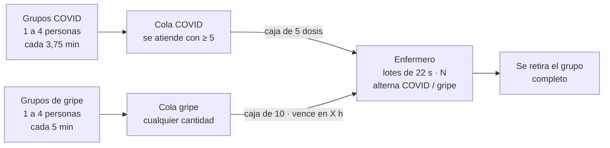
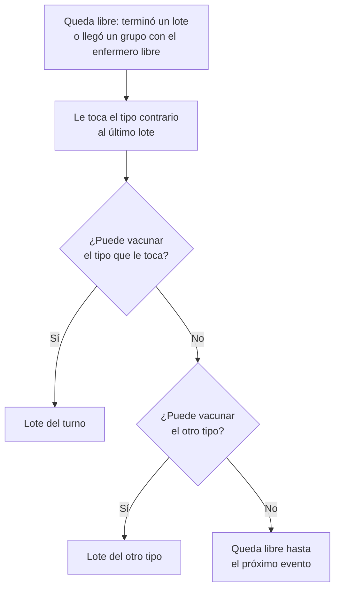
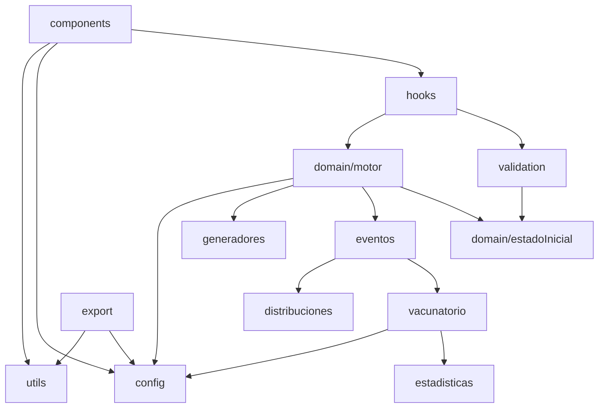
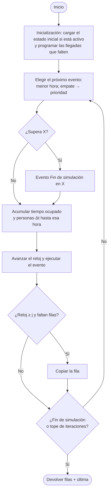

# SIM_2026_4K4_TP4 — Vacunatorio B

Simulación de eventos discretos de un vacunatorio con un solo enfermero, dos tipos de vacuna (COVID y gripe), vacunación por lotes y cajas de dosis con reglas distintas. Trabajo Práctico 4 de **Simulación** (UTN FRC, 2026, curso 4K4, caso Vacunatorio B).

La app tiene dos partes:

- **Presentación**: 8 slides con el caso, las reglas, los objetos, eventos y colas, las variables aleatorias, las estadísticas, las decisiones del grupo y el vector de estado.
- **Simulador**: parámetros editables con unidades y validación, criterios del modelo a la vista, estado inicial opcional, estadísticas finales, vector de estado con selección de fila, foto del instante y exportación a Excel.

---

## Índice

- [Cómo iniciar](#cómo-iniciar)
- [Fechas y entregables](#fechas-y-entregables)
- [El modelo](#el-modelo)
  - [El caso](#el-caso)
  - [Reglas de negocio](#reglas-de-negocio)
  - [Objetos](#objetos)
  - [Eventos](#eventos)
  - [Colas](#colas)
  - [Variables aleatorias](#variables-aleatorias)
  - [Generador congruencial mixto](#generador-congruencial-mixto)
  - [Precisión](#precisión)
- [Estadísticas](#estadísticas)
- [Decisiones del grupo](#decisiones-del-grupo)
- [Criterios configurables](#criterios-configurables)
- [Fin de la simulación](#fin-de-la-simulación)
- [Estado inicial](#estado-inicial)
- [Análisis de resultados](#análisis-de-resultados)
- [Vector de estado](#vector-de-estado)
- [Parámetros](#parámetros)
- [Exportación a Excel](#exportación-a-excel)
- [Presentación](#presentación)
- [Código](#código)

---

## Cómo iniciar

Requiere Node.js 20 o superior.

```bash
npm install
npm run dev       # servidor de desarrollo en http://localhost:5173
npm run build     # compila a dist/
npm run preview   # sirve la versión compilada
```

Para poner grupo e integrantes en la portada, completar `PORTADA.grupo` y `PORTADA.integrantes` en `src/config/constantes.js`. Si quedan vacíos, no se muestran.

---

## Fechas y entregables

| Qué                     | Fecha (según el enunciado) |
| ----------------------- | -------------------------- |
| Clase de consulta       | 28/10/2026                 |
| Presentación presencial | 04/11/2026                 |

Entregables:

1. **Documento** con el análisis y las definiciones del sistema: objetos, eventos, colas, variables aleatorias con sus fórmulas y las fórmulas de lo que se desea averiguar. Este README contiene todo ese material; el documento se puede generar a partir de él.
2. **Aplicativo** que simule el sistema (este proyecto).

---

## El modelo

### El caso

A un vacunatorio que atiende las 24 horas llegan pequeños grupos de personas para vacunarse contra COVID o contra la gripe. Un único enfermero aplica todas las vacunas, por lotes y de un tipo por vez.



Se desea conocer:

1. Cuántas cajas de vacunas contra la gripe se colocaron en el tiempo simulado.
2. Cuántas dosis de gripe se descartaron por vencimiento.
3. La espera promedio de los grupos que van por la vacuna contra COVID.
4. La espera promedio de los grupos que van por la vacuna contra la gripe.

### Reglas de negocio

1. El vacunatorio funciona las 24 horas, sin cierre.
2. Llegan grupos de dos tipos con corrientes de llegada independientes: COVID (exponencial, 4 veces cada 15 minutos) y gripe (exponencial, media 5 minutos).
3. Cada grupo trae de 1 a 4 personas con igual probabilidad, todas para la misma vacuna.
4. Hay una cola por tipo, por orden de llegada de los grupos, sin límite y sin abandono.
5. El enfermero vacuna **por lotes**: un lote de N personas tarda 22 · N segundos. En COVID el lote se arma tomando personas de los grupos por orden de llegada; en gripe el lote es **un grupo completo**.
6. **Alternancia preferente**: al quedar libre le toca el tipo contrario al último lote. Si no puede atender ese tipo, atiende el otro. Nunca queda libre si puede vacunar a alguien.
7. **COVID**: la caja trae 5 dosis y se abre solo si hay al menos 5 pacientes pendientes. Cada lote de COVID usa una caja: exactamente 5 personas. Nunca sobran dosis de COVID.
8. **Gripe**: el lote es el primer grupo de la cola, completo, y la caja de 10 dosis se abre **a demanda**, cuando se atiende al grupo (no antes). Si la caja abierta alcanza, se descuentan las dosis del grupo; si no alcanza (o no hay caja), se usan las que quedan y se completa con una caja nueva. Ejemplos: grupo de 4 con 10 dosis → sobran 6; grupo de 4 con 3 dosis → se usan las 3, esa caja se agota y se abre otra que queda con 9; grupo de 1 con 10 dosis → sobran 9.
9. Las dosis de gripe sobrantes vencen **X horas después de abierta la caja** y se descartan.
10. **Grupo partido (solo COVID)**: si el lote de 5 no alcanza para todo el grupo, se vacuna una parte y el resto queda "Esperando resto", al frente de su cola. El grupo se retira completo, cuando todos están vacunados. En gripe nunca se parte un grupo.
11. Para el mínimo de 5 pacientes de COVID se cuentan solo los **pendientes** (los que todavía no empezaron a vacunarse).
12. Las dosis se descuentan al **iniciar** el lote. Si una caja de gripe se agota (aunque sea a mitad de un grupo), su vencimiento se cancela y la caja deja de existir.

Decisión del enfermero cada vez que queda libre:



Puede vacunar COVID con al menos 5 pendientes; gripe, con al menos 1.

### Objetos

| Objeto         | Tipo                                   | Estados                                                         | Otros atributos                                                                                                                  |
| -------------- | -------------------------------------- | --------------------------------------------------------------- | -------------------------------------------------------------------------------------------------------------------------------- |
| Enfermero      | Permanente · servidor                  | Libre · Vacunando COVID · Vacunando gripe                       | Último tipo aplicado, composición del lote, personas en el lote, duración del lote, hora de fin de vacunación                    |
| Grupo COVID    | Temporal · cliente                     | Esperando · Vacunándose · Vacunándose parcial · Esperando resto | Identificador (COV-n), tamaño, vacunados, en lote, pendientes, hora de llegada, hora de inicio de vacunación, lugar en el vector |
| Grupo de gripe | Temporal · cliente                     | Esperando · Vacunándose (no se parte)                           | Ídem (identificador GRI-n); en lote entra completo                                                                               |
| Caja de gripe  | Temporal: existe mientras está abierta | Sin caja · Abierta                                              | Número, dosis restantes, hora de apertura, hora de vencimiento                                                                   |

En un grupo siempre se cumple: **vacunados + en lote + pendientes = tamaño**.

| Estado del grupo    | Significado                                                               |
| ------------------- | ------------------------------------------------------------------------- |
| Esperando           | Nadie del grupo empezó a vacunarse.                                       |
| Vacunándose         | Todos sus pendientes están en el lote actual; se retira al terminar.      |
| Vacunándose parcial | Solo COVID: una parte está en el lote de 5; el resto no entró.            |
| Esperando resto     | Solo COVID: ya se vacunó una parte; espera el próximo lote para el resto. |

La caja de COVID no es un objeto: se abre y se usa completa al iniciar el lote, así que alcanza con contarla.

### Eventos

| Evento                 | Tipo            | Qué hace                                                                                                                          |
| ---------------------- | --------------- | --------------------------------------------------------------------------------------------------------------------------------- |
| Inicialización         | —               | Carga el estado inicial (si está activo) y programa las llegadas que no vinieron dadas                                            |
| Llegada grupo COVID    | Llegada         | Sortea próxima llegada y tamaño; el grupo entra a su cola; si el enfermero está libre, intenta arrancar un lote                   |
| Llegada grupo gripe    | Llegada         | Ídem para gripe                                                                                                                   |
| Fin de vacunación      | Fin de atención | Se retiran los grupos completos; los partidos (COVID) pasan a "Esperando resto"; el enfermero elige el próximo lote o queda libre |
| Vencimiento caja gripe | Temporal        | Descarta las dosis sobrantes; la caja deja de existir                                                                             |
| Fin de simulación      | Temporal        | En el instante X: última fila                                                                                                     |

### Colas

| Cola       | Disciplina     | Límite / abandono        | Condición de atención                            |
| ---------- | -------------- | ------------------------ | ------------------------------------------------ |
| Cola COVID | FIFO por grupo | Sin límite, sin abandono | Al menos 5 pacientes pendientes                  |
| Cola gripe | FIFO por grupo | Sin límite, sin abandono | Al menos 1 pendiente; un grupo completo por lote |

Entre las dos colas decide la **alternancia preferente**: un tipo por lote.

### Variables aleatorias

| Variable                    | Distribución                                  | Fórmula teórica             | Fórmula con los valores del caso |
| --------------------------- | --------------------------------------------- | --------------------------- | -------------------------------- |
| Tiempo entre llegadas COVID | Exponencial negativa, media 15 / 4 = 3,75 min | T = −μ · ln(1 − RND)        | T = −3,75 · ln(1 − RND)          |
| Tiempo entre llegadas gripe | Exponencial negativa, media 5 min             | T = −μ · ln(1 − RND)        | T = −5 · ln(1 − RND)             |
| Personas por grupo          | Uniforme discreta [1; 4]                      | N = a + ⌊RND · (b − a + 1)⌋ | N = 1 + ⌊RND · 4⌋                |

La duración del lote (22 · N segundos) **no es aleatoria**: no usa RND.

### Generador congruencial mixto

```
X(n+1) = (a · X(n) + c) mod m        RND = X / m ∈ [0; 1)
```

- Valores del enunciado: semilla 1234, a = 1714, c = 1221, m = 3922.
- **Un solo generador, compartido**: cada variable toma el siguiente número de la misma secuencia, en el orden en que se necesita. No se usa el generador del lenguaje.
- El primer RND sale de X1; la semilla no se usa como RND.
- Orden de uso: al inicializar, primero la llegada COVID y después la de gripe; en cada llegada, primero el tiempo hasta la próxima llegada y después las personas del grupo (ver [Criterios configurables](#criterios-configurables)).

**Ciclo**: con estos parámetros la secuencia se repite cada **468 números**. El período no es completo porque c y m comparten el factor 37 (mcd(1221, 3922) = 37). Cada llegada consume 2 números, así que el ciclo se recorre en unas 234 llegadas, y en corridas largas los RND se reciclan muchas veces. No es un error del programa: es consecuencia de los parámetros. El formulario muestra el ciclo en vivo para los valores cargados.

### Precisión

Un único parámetro (completa, 4, 3 o 2 decimales) **trunca** todo número no entero en el momento de calcularlo: RND, tiempos, horas y acumuladores. Nunca se redondea: un RND redondeado a 1 haría que la exponencial calcule ln(0). La pantalla también trunca al mostrar (6 decimales con precisión completa) y el Excel exporta con esa misma cantidad.

Para sumar otra precisión, agregar `{ valor: 5, etiqueta: "5 decimales" }` a `PRECISIONES` en `src/config/constantes.js`.

---

## Estadísticas

Se calculan con contadores y acumuladores que se actualizan en cada evento. Se muestran en el vector y su valor final sale de la última fila.

### Lo que pide el enunciado

| Estadística                      | Cálculo                                                                                        |
| -------------------------------- | ---------------------------------------------------------------------------------------------- |
| Cajas de gripe colocadas         | Contador: +1 cada vez que se abre una caja. Incluye la que quede abierta al final.             |
| Dosis de gripe aplicadas         | Contador: + N al iniciar cada lote de gripe.                                                   |
| Dosis de gripe descartadas       | Σ dosis restantes en cada evento de vencimiento.                                               |
| Dosis de gripe sin usar al final | Dosis de la caja abierta en el instante X (todavía no vencieron: no cuentan como descartadas). |
| Espera promedio COVID            | Σ esperas de los grupos COVID / grupos COVID que empezaron a vacunarse.                        |
| Espera promedio gripe            | Σ esperas de los grupos de gripe / grupos de gripe que empezaron a vacunarse.                  |

**Espera de un grupo** = hora en que empieza a vacunarse su primer integrante − hora de llegada. Los grupos que siguen esperando al final no entran en el promedio. La opción "último integrante" está en el código (ver [Criterios configurables](#criterios-configurables)).

### Estadísticas adicionales

| Estadística                                        | Cálculo                                                          |
| -------------------------------------------------- | ---------------------------------------------------------------- |
| Ocupación del enfermero                            | Σ tiempo ocupado / tiempo simulado                               |
| Espera máxima por tipo                             | Mayor espera registrada                                          |
| Personas promedio en cola por tipo                 | Σ (personas en cola · Δt) / tiempo simulado (área bajo la curva) |
| Permanencia promedio por tipo                      | Σ (hora de retiro − hora de llegada) / grupos retirados          |
| Cajas de COVID abiertas y dosis de COVID aplicadas | Contadores (5 dosis por caja)                                    |
| % de dosis de gripe descartadas                    | Descartadas / (cajas de gripe abiertas · 10)                     |

"Personas en cola" son las **pendientes**: las que todavía no empezaron a vacunarse. Las que están en el lote no cuentan.

---

## Decisiones del grupo

| Tema                         | Decisión                                                                                                                                                                   |
| ---------------------------- | -------------------------------------------------------------------------------------------------------------------------------------------------------------------------- |
| Reloj                        | En minutos. X y j se cargan en horas o minutos (conversor); el vencimiento en horas o minutos; la vacunación en segundos. Todo se pasa a minutos.                          |
| Valores por defecto          | X = 24 h (el vacunatorio atiende las 24 horas), vencimiento 1 h, j = 0, i = 100, tope 100.000. El enunciado no los fija.                                                   |
| Valores fijos                | Cajas de 5 y 10 dosis y mínimo de 1 persona por grupo: no están en rojo, quedan como constantes en el código.                                                              |
| Orden de los RND             | Inicialización: COVID y después gripe. En cada llegada: próxima llegada y después personas. Configurable.                                                                  |
| Cola y lote                  | Cola por grupo; el lote toma personas en ese orden.                                                                                                                        |
| Lote de COVID                | Una caja por lote: exactamente 5 personas.                                                                                                                                 |
| Lote de gripe                | Un grupo completo por lote (el primero de la cola). Nunca se parte.                                                                                                        |
| Grupo partido                | Solo COVID: queda "Esperando resto" al frente de su cola y se retira completo. Para el mínimo de 5 cuentan solo los pendientes.                                            |
| Apertura de la caja de gripe | A demanda, al atender al grupo (no al llegar). Si la caja abierta no alcanza, se usan sus dosis y se completa con una nueva: no se desperdicia nada.                       |
| Vencimiento                  | Las dosis se usan al iniciar el lote; el vencimiento descarta solo las no asignadas. Si la caja se agota, el vencimiento se cancela.                                       |
| Alternancia                  | Preferente: si no puede atender el tipo que le toca, atiende el otro.                                                                                                      |
| Primer lote                  | Decide quién llega primero. El desempate (COVID) solo actúa si, sin lote anterior, se pueden atender ambos tipos en el mismo instante.                                     |
| Espera                       | Hasta que empieza a vacunarse el primer integrante.                                                                                                                        |
| "Cajas colocadas"            | Cajas abiertas, incluida la que esté abierta al final.                                                                                                                     |
| Eventos simultáneos          | Vencimiento > fin de vacunación > llegada COVID > llegada gripe.                                                                                                           |
| Última fila                  | Se muestra siempre, con los grupos presentes al terminar.                                                                                                                  |
| Precisión                    | Truncar, nunca redondear (igual que el TP3).                                                                                                                               |
| Estado inicial               | Opcional, en `src/config/estadoInicial.js` (por defecto arranca vacío). El reloj 0 es el inicio; lo anterior tiene horas negativas. Ver [Estado inicial](#estado-inicial). |

---

## Criterios configurables

Las interpretaciones discutibles están en `src/config/criteriosModelo.js`. Se cambian ahí sin tocar la lógica.

Los criterios con que corre la simulación se ven en tres lugares, y todos toman sus textos de `src/utils/descripcionCriterios.js`:

- **Simulador**: bloque "Criterios del modelo" al final del formulario, de solo lectura, con el valor de cada criterio y qué significa.
- **Presentación**: slides 4, 5, 6 y 7 y el diagrama del motor.
- **Excel**: hoja "Criterios del modelo", con el criterio, el valor usado y qué significa.

Al cambiar un criterio en `criteriosModelo.js`, todo eso se actualiza solo. Lo único que hay que editar a mano es este README.

| Constante                       | Valor actual                                                 | Qué cambia                                                                                                                                                                                                               |
| ------------------------------- | ------------------------------------------------------------ | ------------------------------------------------------------------------------------------------------------------------------------------------------------------------------------------------------------------------ |
| `ORDEN_LLEGADAS_INICIALES`      | `[COVID, GRIPE]`                                             | Qué llegada se sortea primero en la inicialización. Invertir el arreglo para empezar por gripe.                                                                                                                          |
| `ORDEN_RND_EN_LLEGADA`          | `[PROXIMA_LLEGADA, TAMANIO_GRUPO]`                           | Qué se sortea primero en cada llegada. Invertir el arreglo para sortear primero las personas.                                                                                                                            |
| `CRITERIO_ESPERA`               | `PRIMER_INTEGRANTE`                                          | Hasta cuándo se mide la espera. Con `ULTIMO_INTEGRANTE`, un grupo partido (solo pasa en COVID) termina su espera cuando entra al lote su último integrante. En los grupos que no se parten ambos criterios dan lo mismo. |
| `PRIORIDAD_EVENTOS_SIMULTANEOS` | Vencimiento, fin de vacunación, llegada COVID, llegada gripe | Orden entre eventos del mismo instante.                                                                                                                                                                                  |
| `TURNO_INICIAL`                 | `COVID`                                                      | Desempate del primer lote.                                                                                                                                                                                               |

Los dos órdenes de RND cambian qué número aleatorio usa cada variable, y por lo tanto todas las filas.

---

## Fin de la simulación

- La simulación termina en el **tiempo X** o al llegar al **tope de iteraciones** (máximo 100.000), lo que ocurra primero.
- Si termina por tiempo, la última fila es el evento **Fin de simulación** en el instante X. Los acumuladores de tiempo (ocupación y personas · Δt) se cierran en X.
- La última fila se muestra siempre, **con los grupos que quedaron en el sistema**.
- **Grupos esperando al final**: no entran en los promedios de espera ni de permanencia.
- **Caja de gripe abierta al final**: sus dosis no vencieron todavía, así que **no se cuentan como descartadas**. Se informan aparte como "dosis sin usar al final". La caja sí cuenta como colocada.
- Un lote en curso al final: su tiempo ocupado se cuenta hasta X; sus grupos figuran como "Vacunándose" en la última fila.

---

## Estado inicial

Por defecto la simulación arranca con el vacunatorio vacío, como si recién abriera (`activo: false`). También puede arrancar desde una situación puntual, con grupos esperando, un lote en curso y una caja abierta. Se configura en `src/config/estadoInicial.js` poniendo `activo: true` y completando los datos.

### Cómo se describe

**El reloj 0 es el inicio de la simulación.** Lo que pasó antes se escribe con horas negativas: un grupo que llegó hace 6 minutos tiene `horaLlegada: -6`. Así X, j y el resto de los parámetros no cambian de significado.

| Parte            | Qué se carga                                                                                                                                                 |
| ---------------- | ------------------------------------------------------------------------------------------------------------------------------------------------------------ |
| `proximaLlegada` | Próxima llegada de COVID y de gripe (en minutos, mayor a 0). Con `null` se sortea como siempre, consumiendo un RND en el orden de los criterios.             |
| `grupos`         | Grupos presentes por tipo, en orden de llegada: tamaño, vacunados, en lote, pendientes y hora de llegada. El estado de cada grupo se deduce de esos números. |
| `enfermero`      | `finVacunacion` (obligatorio si hay un lote en curso, `null` si no) y `ultimoTipoAplicado` (solo se usa si arranca libre).                                   |
| `cajaGripe`      | Dosis restantes, hora de apertura y hora de vencimiento. `null` si no hay caja abierta.                                                                      |

El **lote en curso no se carga aparte**: se deduce de los grupos que tienen personas "en lote". Así es más difícil cargar algo incoherente.

Ejemplo (el que viene en el archivo): dos grupos de COVID esperando (3 y 2 personas, 5 pendientes), el enfermero vacunando un grupo de gripe de 4 (completo) hasta el minuto 0,9, y una caja de gripe abierta hace 25 minutos con 4 dosis, que vence en el minuto 35.

### Validación

El estado se valida contra las reglas del modelo y contra los **parámetros actuales del formulario**:

- En cada grupo, vacunados + en lote + pendientes = tamaño, y el tamaño respeta el máximo de personas por grupo.
- Un grupo ya vacunado completo no puede seguir en el sistema, y su hora de llegada es ≤ 0.
- El lote en curso es de un solo tipo: exactamente 5 personas si es COVID; si es gripe, un solo grupo completo.
- Los grupos de gripe no se parten: ninguno tiene vacunados, y el que está en lote no tiene pendientes.
- El fin del lote es mayor a 0 y no puede superar su duración completa (personas · segundos por persona). Sin lote, el fin de vacunación es `null`.
- La caja tiene entre 1 y 10 dosis, se abrió antes del inicio, vence después del inicio y vence exactamente "vencimiento" minutos después de abierta.
- Las próximas llegadas son mayores a 0 o `null`, y el último tipo aplicado es COVID, gripe o `null`.

Si está activo, el formulario muestra un bloque **"Estado inicial"** con el resumen de lo cargado: grupos, enfermero, caja y próximas llegadas. Si algo no cierra, aparece la lista de errores en rojo y **"Simular" queda bloqueado**. Se reevalúa en vivo: si cambiás un parámetro del que depende (máximo de personas, segundos por persona o vencimiento), los errores aparecen o desaparecen solos.

El motor vuelve a validar al arrancar, como red de seguridad: si algo se escapara, el error se muestra en el aviso rojo del simulador.

### Cómo arranca

- La **fila 0** muestra el estado cargado: grupos en sus lugares, enfermero, caja (como "caja 0") y próximas llegadas.
- Se sortean solo las llegadas que no vinieron dadas.
- Si el estado deja al enfermero libre con gente para vacunar, arranca un lote en la misma fila 0.
- Los grupos siguen la numeración: si había dos grupos de COVID, el próximo que llega es COV-3.
- La slide 5 ("Primeros RND y dónde se usaron") se arma siempre con el sistema vacío, porque muestra cómo funciona el generador y no un estado cargado.

### Decisiones sobre las estadísticas

| Tema                                          | Decisión                                                                                                                                 |
| --------------------------------------------- | ---------------------------------------------------------------------------------------------------------------------------------------- |
| Espera de los grupos que ya estaban esperando | Se mide desde su llegada real, incluido el tiempo anterior al inicio.                                                                    |
| Grupos que ya habían empezado a vacunarse     | Su espera ocurrió antes del inicio: no se registra.                                                                                      |
| Caja abierta antes del inicio                 | Se muestra como "caja 0". No cuenta como caja colocada en el tiempo simulado; sus dosis aplicadas y, si vence, sus descartes sí cuentan. |
| Acumuladores                                  | Arrancan en cero: se mide solo lo que pasa desde el inicio.                                                                              |
| Balance de dosis                              | Cajas colocadas · 10 + dosis iniciales de la caja 0 = aplicadas + descartadas + sin usar al final.                                       |

---

## Análisis de resultados

Con los valores por defecto (24 h, generador del enunciado, precisión completa) se simulan **1130 iteraciones**:

| Estadística                             | Valor                    |
| --------------------------------------- | ------------------------ |
| Cajas de gripe colocadas                | 72                       |
| Dosis de gripe aplicadas                | 714                      |
| Dosis de gripe descartadas              | 0                        |
| Dosis de gripe sin usar al final        | 6                        |
| Espera promedio COVID                   | 2,920061 min             |
| Espera promedio gripe                   | 0,533998 min             |
| Ocupación del enfermero                 | 41,09 %                  |
| Espera máxima COVID / gripe             | 21,681152 / 7,109541 min |
| Personas promedio en cola COVID / gripe | 2,267226 / 0,257284      |
| Permanencia promedio COVID / gripe      | 6,882029 / 1,443026 min  |
| Cajas / dosis de COVID                  | 180 / 900                |

**Lectura**:

- COVID espera bastante más que gripe porque tiene que juntar 5 pendientes antes de que se abra una caja. La espera máxima de COVID (~22 min) corresponde a un grupo que llegó con pocos pacientes en cola.
- El enfermero está ocupado ~41 % del tiempo: el sistema es estable y las colas no crecen sin control.
- Una caja de gripe se vacía en unos 20 minutos en promedio (llegan ~0,5 personas de gripe por minuto). Por eso, con vencimiento de 1 hora o más, **no se descarta ninguna dosis**.

Efecto del vencimiento sobre las preguntas de gripe (24 h, resto por defecto):

| Vencimiento | Cajas colocadas | Dosis descartadas |
| ----------- | --------------- | ----------------- |
| 15 min      | 91              | 191               |
| 30 min      | 74              | 18                |
| 1 h         | 72              | 0                 |
| 2 h         | 72              | 0                 |

Con vencimientos cortos se abren más cajas: cada caja que vence con dosis sobrantes obliga a abrir otra.

Como las cajas se abren a demanda y un grupo puede completarse con dos cajas, una caja solo pierde dosis si vence: con 1 hora de vencimiento, las 72 cajas dan 714 dosis aplicadas, 0 descartadas y 6 sin usar al final (72 · 10 = 714 + 0 + 6).

---

## Vector de estado

### Grupos de columnas

| Grupo                         | Columnas                                                                                                                         |
| ----------------------------- | -------------------------------------------------------------------------------------------------------------------------------- |
| Fila                          | Número de fila (siempre anclada al hacer scroll horizontal; con el botón "Fijar evento y reloj" también se anclan esas columnas) |
| Evento y reloj                | Evento, reloj en minutos, hora hh:mm:ss                                                                                          |
| Llegada grupo COVID / gripe   | RND llegada, tiempo entre llegadas, próxima llegada, RND tamaño, personas                                                        |
| Enfermero (servidor)          | Estado, motivo del lote, composición del lote, personas en lote, duración del lote, fin de vacunación, último tipo aplicado      |
| Caja de gripe abierta         | Estado, número, dosis restantes, hora de apertura, vencimiento, novedad de caja                                                  |
| Colas                         | Personas y grupos en cola, por tipo                                                                                              |
| Cajas y dosis                 | Cajas y dosis de gripe (abiertas, aplicadas, descartadas) y de COVID                                                             |
| Espera grupos COVID / gripe   | Σ espera, grupos, promedio, máxima                                                                                               |
| Permanencia                   | Σ permanencia y grupos retirados, por tipo                                                                                       |
| Acumuladores de tiempo        | Tiempo ocupado del enfermero, Σ personas · Δt por tipo                                                                           |
| Grupo COVID / gripe · lugar k | Grupo, estado, tamaño, vacunados, en lote, pendientes, hora de llegada                                                           |

Los **próximos eventos** están en sus objetos: próxima llegada (en cada bloque de llegada), fin de vacunación (enfermero) y vencimiento (caja). Los RND y los valores sorteados aparecen solo en la fila del evento que los usó.

Columnas que hacen visibles las reglas:

- **Motivo del lote**: aparece solo en la fila donde arranca un lote. Valores: "Primer lote", "Turno COVID", "Turno gripe", "COVID sin 5 → gripe" y "Sin gripe → COVID".
- **Composición del lote**: por ejemplo "COV-4 ×2 + COV-5 ×3" son 2 personas del grupo COVID 4 y 3 del 5. Así se ve cuándo un grupo se partió.
- **Novedad de caja**: "Abre caja 12", "Caja 12 agotada" o "Vence caja 12: descarta 4".

### Lugares reutilizables

Cada grupo ocupa un **lugar** de su tipo al llegar (el primero libre) y lo conserva hasta retirarse, así se lo sigue en horizontal fila a fila. La cantidad de lugares es la máxima de grupos simultáneos en las filas mostradas, incluida la última. Esto evita una columna por grupo: en 24 horas llegan más de 650 grupos, pero simultáneos hay muy pocos.

### Selección de fila y foto del instante

- Clic en una fila para seleccionarla, o flechas ↑ ↓ con la tabla enfocada. Con las flechas, la tabla (y la página, si hace falta) acompaña a la fila para que no salga de la vista. La selección se mantiene al hacer scroll vertical u horizontal.
- El botón **"Fijar evento y reloj"** (arriba a la derecha de la tabla) deja anclados el evento, el reloj y la hora junto a la fila al desplazarse a la derecha. Se vuelve a tocar para soltarlos.
- La tabla es virtualizada (solo dibuja las filas visibles), con encabezados anclados y sin parpadeos, aunque se muestren 100.000 filas.
- Debajo, la **foto del instante** muestra la fila seleccionada como tarjetas: el enfermero, la caja de gripe y cada grupo con su estado. Cada persona del grupo es un punto: lleno (vacunada), amarillo (en el lote actual) o hueco (pendiente).
- Junto al título de la foto, **"← Anterior" y "Siguiente →"** pasan a la fila mostrada anterior o siguiente (incluida la última, aunque haya quedado fuera de las mostradas); la tabla se desplaza hasta esa fila. Se desactivan en la primera y en la última; sin fila seleccionada, "Siguiente" arranca por la primera.
- La foto lista los **próximos eventos programados ordenados por hora** (si empatan, por la prioridad configurada). El primero, marcado "el siguiente", es el evento de la fila de abajo.

**Qué son los próximos eventos**: en cada instante solo se conoce el próximo evento de cada tipo (una llegada COVID, una de gripe, el fin del lote en curso y el vencimiento de la caja abierta). Los demás se generan a medida que ocurren: por ejemplo, el fin de un lote que todavía no arrancó no figura hasta que ese lote empieza. Por eso la lista no coincide con todas las filas que siguen, pero el primero siempre es la fila de abajo.

### Ejemplo: primeras filas con los valores por defecto

| Fila | Evento              | Reloj    | Qué pasa                                                                                                                                                                                                                    |
| ---- | ------------------- | -------- | --------------------------------------------------------------------------------------------------------------------------------------------------------------------------------------------------------------------------- |
| 0    | Inicialización      | 0        | X1 = (1714 · 1234 + 1221) mod 3922 = 2339 → RND 0,596379 → próxima llegada COVID = −3,75 · ln(1 − 0,596379) = 3,402299. X2 = 1983 → RND 0,505609 → próxima llegada gripe = −5 · ln(1 − 0,505609) = 3,522146.                |
| 1    | Llegada grupo COVID | 3,402299 | RND 0,925803 → próxima llegada COVID 13,156176. RND 0,137939 → N = 1 + ⌊0,1379 · 4⌋ = 1. COV-1 espera: hay menos de 5 pendientes.                                                                                           |
| 2    | Llegada grupo gripe | 3,522146 | RND 0,740183 → próxima gripe 10,261046. RND 0,985976 → N = 4. Enfermero libre, primer lote: COVID no alcanza → gripe. Abre caja 1 (vence 63,522146). Lote GRI-1 ×4: 4 · 22 s = 1,466666 min → fin 4,988813. Quedan 6 dosis. |
| 3    | Fin de vacunación   | 4,988813 | GRI-1 se retira (espera 0, permanencia 1,466666). Nadie más para vacunar: el enfermero queda libre.                                                                                                                         |

---

## Parámetros

Todos los valores en rojo del enunciado son parametrizables. El formulario queda visible después de simular y avisa si se cambió algo después de la última corrida.

| Grupo              | Parámetro                 | Unidad       | Por defecto            | Validación                                                                         |
| ------------------ | ------------------------- | ------------ | ---------------------- | ---------------------------------------------------------------------------------- |
| Ejecución          | Tiempo a simular (X)      | h ↔ min      | 24 h = 1440 min        | Mayor a 0                                                                          |
|                    | Tope de iteraciones       | filas        | 100.000                | Entero entre 1 y 100.000                                                           |
|                    | Mostrar desde la hora (j) | h ↔ min      | 0                      | ≥ 0 y ≤ X                                                                          |
|                    | Filas a mostrar (i)       | filas        | 100                    | Entero entre 1 y 100.000                                                           |
|                    | Precisión                 | —            | Completa               | Completa, 4, 3 o 2 decimales                                                       |
| Generador          | Semilla X0, a, c, m       | —            | 1234, 1714, 1221, 3922 | Enteros; m ≥ 2; a ≥ 1; c ≥ 0; semilla < m; a·(m−1)+c dentro de la precisión entera |
| Llegadas COVID     | Llegadas / cada           | grupos / min | 4 cada 15 (media 3,75) | Mayores a 0                                                                        |
| Llegadas gripe     | Media entre llegadas      | min          | 5                      | Mayor a 0                                                                          |
| Personas por grupo | Máximo                    | personas     | 4 (mínimo fijo 1)      | Entero ≥ 1                                                                         |
| Vacunación         | Tiempo por persona        | s            | 22 (= 0,3666 min)      | Mayor a 0                                                                          |
| Caja de gripe      | Vencimiento               | h ↔ min      | 1 h = 60 min           | Mayor a 0                                                                          |

- **Conversor horas ↔ minutos**: en X, j y vencimiento se completa cualquiera de los dos inputs y el otro se actualiza solo. Se guarda y se valida el valor en minutos.
- **Mostrar todas las filas** pone j = 0 e i = tope de iteraciones. Antes de simular no se sabe cuántas iteraciones habrá, pero nunca pueden ser más que el tope.
- **Restaurar valores del enunciado** vuelve a los valores por defecto.
- **Estado inicial**: si está activo, el formulario muestra su resumen y sus errores; con errores no se puede simular (ver [Estado inicial](#estado-inicial)).
- **Criterios del modelo**: al final del formulario se ven, de solo lectura, los criterios configurados en el código (ver [Criterios configurables](#criterios-configurables)).

---

## Exportación a Excel

Exporta exactamente las filas que muestra la tabla (desde la hora j, i filas, más la última, resaltada). Para exportar toda la simulación, usar "Mostrar todas las filas" antes de simular.

| Hoja                 | Contenido                                                                           |
| -------------------- | ----------------------------------------------------------------------------------- |
| Vector de estado     | Encabezado agrupado en dos filas, con los mismos colores por objeto que en pantalla |
| Estadísticas         | Iteraciones, reloj final, corte y estadísticas con su unidad                        |
| Parámetros           | Los usados en la corrida, tal como se cargaron, con su unidad                       |
| Criterios del modelo | Criterio, valor usado y qué significa, según `criteriosModelo.js`                   |

Los decimales van truncados a la precisión elegida (6 si es "Completa") y las celdas quedan numéricas.

**Exportaciones grandes**: con "Mostrar todas las filas" y el tope de 100.000 iteraciones, el vector tiene más de 15 millones de celdas. Librerías como exceljs arman todo el libro en memoria y hacen colapsar la pestaña del navegador. Por eso `src/export/escritorXlsx.js` escribe el .xlsx de a bloques de 2000 filas y comprime cada bloque apenas se genera (con fflate). Así, 100.000 filas se exportan en unos 15 segundos (archivo de ~30 MB), y el archivo abre en Excel y LibreOffice.

---

## Presentación

8 slides a pantalla completa (navegación con flechas ↑ ↓, Inicio y Fin). Ninguna necesita scroll en 1280 × 720, 1366 × 768 ni 1440 × 900. Los textos que dependen de los criterios del modelo (orden de los RND, criterio de espera, prioridad de eventos) se leen del código, así que no quedan desfasados.

1. **Portada**: título, materia, curso; grupo e integrantes si están cargados.
2. **El caso**: diagrama del vacunatorio y lo que se desea conocer.
3. **Reglas del enfermero y de las cajas**: lotes, alternancia, cajas, grupo partido y diagrama de decisión.
4. **Objetos, eventos y colas**.
5. **Variables aleatorias y generador compartido**: fórmulas reemplazadas, orden de uso de los RND, ciclo de 468 y primeros RND con su uso (siempre con el sistema vacío, aunque haya un estado inicial activo).
6. **Estadísticas y sus fórmulas**.
7. **Decisiones del grupo**.
8. **Vector de estado y motor**: qué muestra el vector y el ciclo del motor.

---

## Código

### Estructura del proyecto

```
src/
├── main.jsx                          # punto de entrada
├── App.jsx                           # alterna presentación ↔ simulador; guarda parámetros y resultado
│
├── config/
│   ├── constantes.js                 # portada, precisiones, tope, cajas y mínimos fijos
│   ├── parametrosPorDefecto.js       # valores del enunciado y los fijados por el grupo
│   ├── criteriosModelo.js            # interpretaciones configurables (orden de RND, espera, prioridad)
│   ├── estadoInicial.js              # situación de partida (activo: false = arranca vacío)
│   └── columnasVector.js             # esquema único de columnas (tabla y Excel)
│
├── domain/                           # lógica pura, sin React
│   ├── generadores/congruencialMixto.js   # generador compartido y longitud de ciclo
│   ├── distribuciones/               # exponencial, uniforme discreta
│   ├── vacunatorio/
│   │   ├── vocabulario.js            # tipos, eventos, estados, motivos (nombres comunes a toda la app)
│   │   ├── grupos.js                 # creación de grupos, lugares y pendientes
│   │   ├── cajaGripe.js              # apertura de la caja de gripe
│   │   └── enfermero.js              # alternancia, armado y cierre de lotes
│   ├── eventos/                      # llegadaGrupo, finVacunacion, vencimientoCajaGripe
│   ├── estadisticas/acumuladores.js  # contadores, esperas, permanencias, tiempos ponderados
│   ├── estadoInicial.js              # valida y carga el estado inicial sobre el sistema vacío
│   ├── vectorEstado.js               # arma la foto de una fila
│   └── motor.js                      # carga el estado inicial, loop de eventos, corte por X o tope, captura desde la hora j
│
├── validation/validarParametros.js   # reglas por campo y cruzadas, más el estado inicial contra los parámetros
├── hooks/                            # useParametros (formulario), useSimulacion (motor)
├── export/
│   ├── exportarExcel.js              # arma las 4 hojas con las mismas columnas que la tabla
│   └── escritorXlsx.js               # escribe el .xlsx de a bloques (soporta 100.000 filas)
├── utils/                            # truncar, formato, tiempo, parámetros, resumen de estadísticas,
│                                     # descripcionCriterios (textos de los criterios para UI, slides y Excel)
│
├── components/
│   ├── presentacion/                 # Deck, Reveal y las 8 slides
│   ├── diagramas/                    # FlujoVacunatorio, FlujoEnfermero, FlujoMotor (SVG)
│   ├── parametros/                   # 4 grupos, estado inicial y criterios del modelo (solo lectura) y campos
│   ├── resultados/                   # estadísticas, leyenda, vector, foto del instante, estado
│   └── simulador/Simulador.jsx
│
└── styles/                           # tema, presentación, simulador
```

### Dependencias entre capas



`domain/` no importa nada de React. Sí lee `config/` (constantes y criterios del modelo), porque son parte de las reglas.

### Flujo del motor



El motor mantiene un único estado del sistema que cada evento modifica a partir del anterior; solo copia las filas que se muestran y la última.

### Glosario

- **parametro**: texto con puntos que indica dónde está un valor dentro del objeto de parámetros del formulario. Ejemplo: `"llegadas.gripeMediaMinutos"`. Lo usan los campos, `setCampo` y los errores de validación.
- **novedades**: lo que pasa durante un evento y solo aparece en su fila (RND sorteados, motivo del lote, novedad de caja).
- **lugar**: posición de un grupo en las columnas del vector; la conserva hasta retirarse.
- **próximo evento**: el que está programado para cada tipo en un instante dado; el de menor hora es el que ocurre en la fila siguiente.
- **pendientes**: personas de un grupo que todavía no empezaron a vacunarse.
- **reloj 0**: el inicio de la simulación. En el estado inicial, lo que pasó antes se escribe con horas negativas.
- **truncar**: cortar decimales sin redondear, con `crearTruncador`.

### Tecnologías

| Uso                   | Herramienta                                                               |
| --------------------- | ------------------------------------------------------------------------- |
| Interfaz              | React 19 + Vite                                                           |
| Tabla de muchas filas | @tanstack/react-virtual                                                   |
| Excel                 | Escritor .xlsx propio sobre fflate (compresión), cargado solo al exportar |
| Diagramas             | SVG propio                                                                |
| Tipografía            | IBM Plex Sans                                                             |
